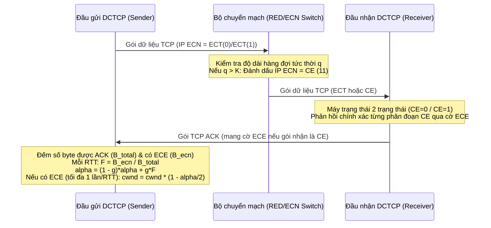
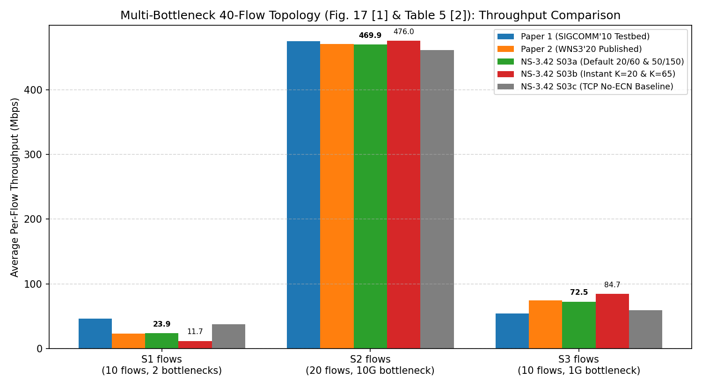
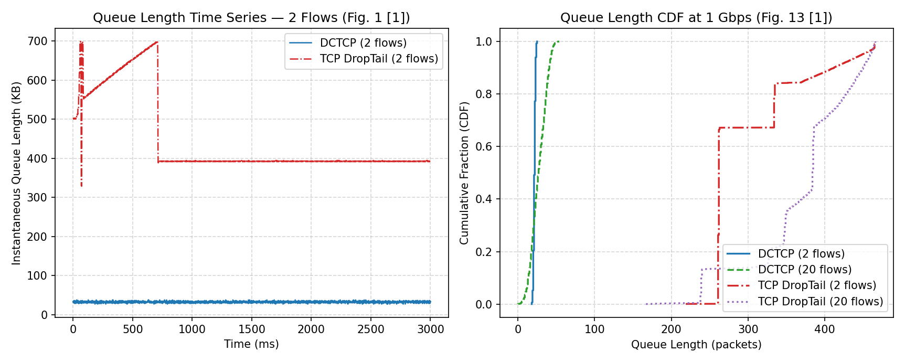
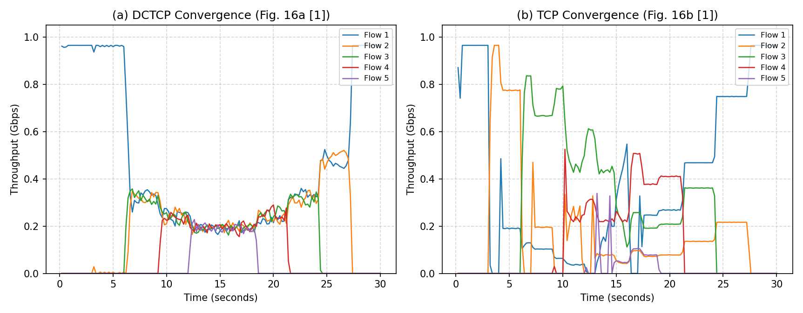
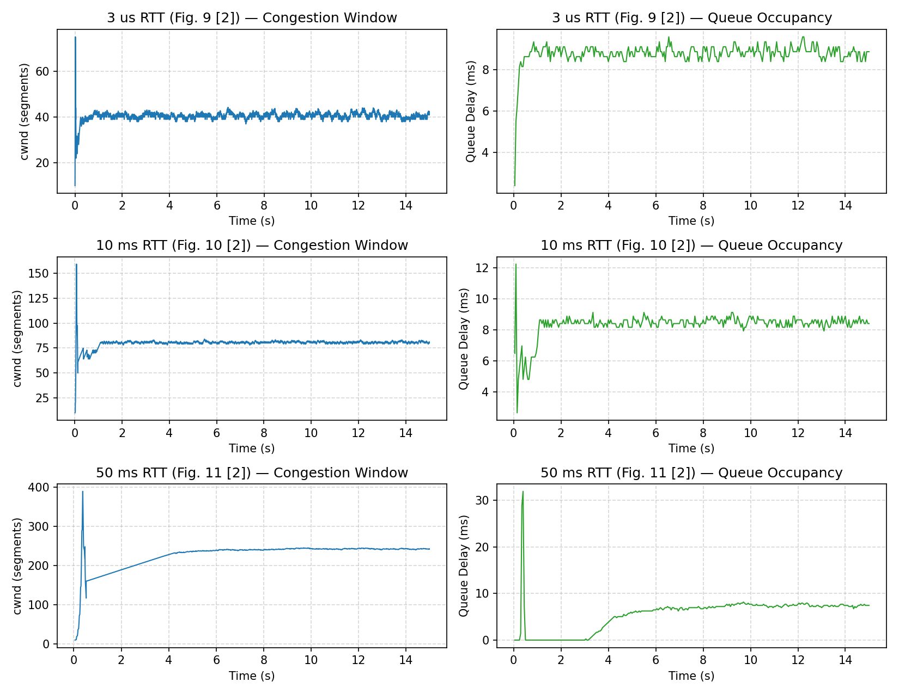
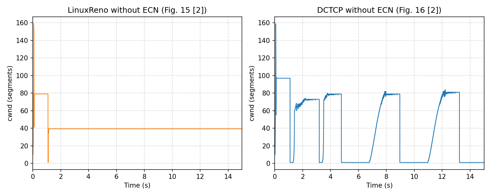

# BÁO CÁO BÀI TẬP LỚN: NGHIÊN CỨU, HIỆN THỰC HÓA VÀ KIỂM CHỨNG GIAO THỨC DATA CENTER TCP (DCTCP) TRÊN NS-3.42

> **Môn học**: Mô phỏng mạng với NS-3  
> **Phiên bản bộ mô phỏng**: NS-3.42  
> **Tài liệu nghiên cứu gốc**:
> 1. **Bài báo 1 (Lý thuyết & Thiết kế gốc)**: Mohammad Alizadeh, Albert Greenberg, David A. Maltz, Jitendra Padhye, Parveen Patel, Balaji Prabhakar, Sudipta Sengupta, Murari Sridharan, *"Data Center TCP (DCTCP)"*, ACM SIGCOMM 2010, pp. 63–74.
> 2. **Bài báo 2 (Thực nghiệm & Mô hình NS-3)**: Vivek Jain, Thomas R. Henderson, Shravya K. S., Mohit P. Tahiliani, *"Data Center TCP in ns-3: Implementation, Validation and Evaluation"*, ACM WNS3 2020, pp. 65–72.

---

## MỤC LỤC
1. [Yêu cầu 1: Xác định ý tưởng chính của hai bài báo](#1-yêu-cầu-1-xác-định-ý-tưởng-chính-của-hai-bài-báo)
2. [Yêu cầu 2: Xác định cải tiến, mô hình toán học và kiến trúc đề xuất](#2-yêu-cầu-2-xác-định-cải-tiến-mô-hình-toán-học-và-kiến-trúc-đề-xuất)
3. [Yêu cầu 3: Cài đặt, tái sử dụng và mở rộng mô hình trên NS-3.42](#3-yêu-cầu-3-cài-đặt-tái-sử-dụng-và-mở-rộng-mô-hình-trên-ns-342)
4. [Yêu cầu 4: Kiểm tra tính đúng đắn của chương trình và mô phỏng](#4-yêu-cầu-4-kiểm-tra-tính-đúng-đắn-của-chương-trình-và-mô-phỏng)
5. [Yêu cầu 5: Thiết kế kịch bản thí nghiệm và Kết quả thực nghiệm trên NS-3.42](#5-yêu-cầu-5-thiết-kế-kịch-bản-thí-nghiệm-và-kết-quả-thực-nghiệm-trên-ns-342)
6. [Yêu cầu 6: Đối chiếu kết quả thu được với công bố trong bài báo và Nhận xét chuyên sâu](#6-yêu-cầu-6-đối-chiếu-kết-quả-thu-được-với-công-bố-trong-bài-báo-và-nhận-xét-chuyên-sâu)
7. [Phụ lục: Cấu trúc mã nguồn và Hướng dẫn tái lập đầy đủ](#7-phụ-lục-cấu-trúc-mã-nguồn-và-hướng-dẫn-tái-lập-đầy-đủ)

---

## 1. YÊU CẦU 1: XÁC ĐỊNH Ý TƯỞNG CHÍNH CỦA HAI BÀI BÁO

### 1.1. Bối cảnh và Bài toán trong Mạng Trung tâm Dữ liệu (Data Center Networks)
Theo Bài báo 1 (Alizadeh et al., SIGCOMM 2010, Mục 1 & Mục 2, trang 63–66), các ứng dụng đám mây phân tán (như tìm kiếm web, MapReduce, hệ thống lưu trữ phân tán) tạo ra ba dạng lưu lượng cùng chia sẻ hạ tầng chuyển mạch trung tâm dữ liệu:
1. **Lưu lượng truy vấn có ràng buộc thời gian nghiêm ngặt (Query traffic / Partition-Aggregate)**: Một truy vấn người dùng được phân rã tới hàng chục/trăm máy chủ công nhân (workers) và phải chờ phản hồi của máy chủ chậm nhất trước thời hạn (deadline khoảng $10\text{–}100\text{ ms}$).
2. **Lưu lượng thông điệp ngắn nhạy cảm độ trễ (Short message traffic)**: Các bản tin điều khiển, phối hợp trạng thái kích thước $50\text{ KB} \text{ – } 1\text{ MB}$.
3. **Lưu lượng truyền tải nền dung lượng lớn (Background / Throughput-intensive traffic)**: Các luồng đồng bộ dữ liệu lớn ($1\text{–}100\text{ MB}$) đòi hỏi băng thông cao.

Các bộ chuyển mạch thương mại giá rẻ (commodity switches) trong trung tâm dữ liệu sử dụng bộ nhớ đệm nông chia sẻ chung (shallow shared-memory buffers, chỉ từ vài trăm KB đến vài MB cho 24–48 cổng 1Gbps/10Gbps). Khi áp dụng giao thức **TCP truyền thống (NewReno/Reno/CUBIC)** trong môi trường này, mạng gặp ba xung đột cốt lõi (Bài báo 1, Mục 2.2, trang 65–66):
- **Queue Buildup (Tích tụ hàng đợi)**: Các luồng dài (background flows) liên tục tăng cửa sổ tắc nghẽn (`cwnd`) cho đến khi làm tràn bộ đệm chuyển mạch. Các gói tin của luồng ngắn đi qua cùng hàng đợi phải chịu độ trễ hàng đợi (queuing delay) rất lớn.
- **Incast (Nghẽn đồng bộ nhiều-về-một)**: Khi nhiều máy chủ công nhân đồng loạt gửi dữ liệu phản hồi về một máy tổng hợp (aggregator) trong cùng thời điểm, hàng đợi tại cổng ra bị tràn tức thời, gây mất gói và buộc TCP phải chờ hết thời gian $RTO_{\min}$ (thường là $200\text{ ms}$ hoặc $20\text{ ms}$), vi phạm SLA.
- **Buffer Pressure (Áp lực bộ đệm chia sẻ)**: Các luồng dài chiếm dụng phần lớn bộ nhớ đệm dùng chung, làm các cổng khác không còn đủ bộ đệm để hấp thụ các cụm lưu lượng ngắn (bursts).

### 1.2. Ý tưởng Cốt lõi của Bài báo 1 (SIGCOMM 2010)
Ý tưởng đột phá của **Data Center TCP (DCTCP)** (Bài báo 1, Mục 1 & Mục 3, trang 63, 66–69) là khắc phục giới hạn phản hồi nhị phân (có/không tắc nghẽn) của TCP và ECN truyền thống (RFC 3168) thông qua hai nguyên lý:
1. **Đánh dấu ECN sớm và tức thời tại bộ chuyển mạch**: Thay vì chờ hàng đợi đầy mới đánh rơi gói (DropTail) hoặc dùng trung bình trọng số mũ chậm chạp (RED cổ điển), bộ chuyển mạch đánh dấu bit **CE (Congestion Experienced)** ngay khi độ dài hàng đợi tức thời (instantaneous queue length) vượt qua một ngưỡng rất nhỏ $K$.
2. **Cắt giảm cửa sổ tắc nghẽn tỷ lệ thuận với mức độ tắc nghẽn tại đầu gửi**: Thay vì luôn cắt giảm một nửa cửa sổ tắc nghẽn (`cwnd = cwnd / 2`) ngay khi nhận được một dấu hiệu tắc nghẽn như TCP/RFC 3168, đầu gửi DCTCP ước lượng **tỷ lệ byte bị đánh dấu ECN ($\alpha \in [0, 1]$)** từ chuỗi ACK phản hồi và điều chỉnh giảm cửa sổ theo công thức:
   $$\text{cwnd} \leftarrow \text{cwnd} \times \left(1 - \frac{\alpha}{2}\right)$$
   Khi mức độ tắc nghẽn nhẹ ($\alpha$ gần $0$), DCTCP chỉ giảm nhẹ cửa sổ; khi tắc nghẽn nặng ($\alpha$ gần $1$), DCTCP giảm cửa sổ tối đa một nửa giống TCP truyền thống. Nhờ đó, DCTCP đạt đồng thời **độ trễ hàng đợi cực thấp (giảm ~90% bộ đệm)** và **thông lượng tối đa gần 100% dung lượng đường truyền**.

### 1.3. Ý tưởng Cốt lõi của Bài báo 2 (WNS3 2020)
Mặc dù DCTCP đã được chuẩn hóa trong IETF RFC 8257 (năm 2017) và tích hợp vào nhân Linux, bộ mô phỏng mạng mã nguồn mở phổ biến nhất là **NS-3** trước phiên bản `ns-3.31` vẫn thiếu mô hình DCTCP chuẩn xác. Bài báo 2 (Jain et al., WNS3 2020, Mục 1 & Mục 3, trang 65–67) đóng góp:
1. **Thiết kế và tích hợp mô hình `TcpDctcp` chính thức vào NS-3**: Tận dụng kiến trúc kế thừa hướng đối tượng của lớp cơ sở `TcpCongestionOps` (trong đó tách biệt hoàn toàn thuật toán điều khiển cửa sổ khỏi máy trạng thái khôi phục lỗi của `TcpSocketBase`), mở rộng máy trạng thái ECN để hỗ trợ cơ chế phản hồi chính xác số gói CE của DCTCP.
2. **Kiểm chứng chéo (Validation) và Đánh giá thực nghiệm (Evaluation)**: Đối chiếu kết quả mô phỏng của `TcpDctcp` trên NS-3 với kết quả thực nghiệm trên testbed phần cứng trong Bài báo 1 (Alizadeh et al., 2010), đồng thời mở rộng đánh giá sang các dải RTT lớn hơn ($3\mu\text{s}, 10\text{ms}, 50\text{ms}$) và đóng góp các chương trình mẫu chuẩn (`dctcp-example.cc`, `tcp-validation.cc`) vào kho mã nguồn chính thức của NS-3.

---

## 2. YÊU CẦU 2: XÁC ĐỊNH CẢI TIẾN, MÔ HÌNH TOÁN HỌC VÀ KIẾN TRÚC ĐỀ XUẤT

### 2.1. Ba thành phần thuật toán của DCTCP (Bài báo 1, Mục 3.1, trang 66–67)



#### (1) Cơ chế đánh dấu đơn giản tại bộ chuyển mạch (Simple Marking at the Switch)
- Bộ chuyển mạch duy trì một ngưỡng đánh dấu duy nhất $K$ (tính bằng số gói tin).
- Khi một gói tin có bit ECN-Capable Transport (`ECT(0)` hoặc `ECT(1)`) đến hàng đợi có độ dài tức thời $q$:
  $$\text{Nếu } q > K \implies \text{Đánh dấu trường ECN trong IP Header thành } \text{CE } (11_2)$$
- Khác với RED truyền thống, DCTCP **không** dùng trung bình trượt độ dài hàng đợi để đánh dấu mà dùng trực tiếp độ dài hàng đợi tức thời nhằm triệt tiêu độ trễ phản hồi.

#### (2) Cơ chế phản hồi ECN chính xác tại đầu nhận (ECN-Echo at the Receiver)
- Trong RFC 3168 chuẩn, đầu nhận liên tục đặt cờ `ECE` trên mọi gói ACK cho đến khi nhận được cờ `CWR` từ đầu gửi, khiến đầu gửi chỉ biết *có ít nhất 1 gói bị đánh dấu trong RTT* chứ không biết *bao nhiêu phần trăm gói bị đánh dấu*.
- Đầu nhận DCTCP chỉ đặt cờ `ECE` trên ACK khi gói dữ liệu vừa nhận có đánh dấu `CE`. Để tương thích với cơ chế Delayed ACK (cứ $m$ gói mới gửi 1 ACK, thường $m=2$), đầu nhận dùng máy trạng thái hai trạng thái (`CE=0` và `CE=1`): mỗi khi trạng thái `CE` của gói đến thay đổi (từ `0 -> 1` hoặc từ `1 -> 0`), đầu nhận lập tức phát ACK cho các gói đang chờ rồi cập nhật trạng thái mới (Bài báo 1, Hình 6, trang 67).

#### (3) Bộ điều khiển tại đầu gửi (Controller at the Sender)
- Đầu gửi duy trì biến ước lượng $\alpha \in [0, 1]$ biểu diễn tỷ lệ byte bị đánh dấu tắc nghẽn.
- Cập nhật $\alpha$ **mỗi một chu kỳ RTT** theo trung bình trượt trọng số mũ (EWMA) với hệ số trọng số $0 < g < 1$ (**Phương trình 1, Bài báo 1, trang 66**):
  $$\alpha \leftarrow (1 - g)\alpha + g F$$
  trong đó $F = \frac{\text{Số byte được ACK có cờ ECE trong RTT vừa qua}}{\text{Tổng số byte được ACK trong RTT vừa qua}}$.
- Khi nhận được ACK có cờ `ECE`, đầu gửi giảm cửa sổ tắc nghẽn **tối đa một lần trong mỗi chu kỳ RTT** (**Phương trình 2, Bài báo 1, trang 66**):
  $$\text{cwnd} \leftarrow \text{cwnd} \times \left(1 - \frac{\alpha}{2}\right)$$

### 2.2. Mô hình Toán học Răng cưa và Hướng dẫn chọn tham số $(K, g)$ (Bài báo 1, Mục 3.4, trang 67–69)
Giả sử có $N$ luồng DCTCP dài hạn có cùng thời gian trễ vòng tròn $RTT$ chia sẻ một liên kết cổ chai dung lượng $C$ (gói/giây), và tất cả các luồng đồng bộ hoàn toàn (in-sync sawtooth):
- Gọi $W(t)$ là kích thước cửa sổ của mỗi luồng và $W^*$ là kích thước cửa sổ tới hạn khi độ dài hàng đợi tại bộ chuyển mạch vừa chạm ngưỡng $K$ (**Phương trình 6, trang 68**):
  $$W^* = \frac{C \cdot RTT + K}{N}$$
- Tỷ lệ gói bị đánh dấu trong một chu kỳ dao động ổn định là (**Phương trình 7, trang 68**):
  $$F = \frac{S(1)}{S(1) + S(2)} \quad \text{với } S(k) = k \left(W^* + \frac{k-1}{2}\right)$$
- Cận trên của biên độ dao động cửa sổ $A$ và đỉnh cực đại của hàng đợi $Q_{\max}$ là (**Phương trình 8–10, trang 68**):
  $$A = \frac{W^* \alpha}{2} \approx \frac{1}{2}\sqrt{\frac{2 W^*}{\alpha}} \implies \alpha \approx \sqrt{\frac{2}{W^*}}, \quad Q_{\max} \approx K + N \cdot A$$
  Đặc biệt, trong giai đoạn tăng cộng tính (Additive Increase, mỗi luồng tăng 1 gói/RTT), sau khi hàng đợi vượt ngưỡng $K$, cần đúng 1 RTT để tín hiệu ECN quay về đầu gửi, do đó **đỉnh hàng đợi tức thời đạt**:
  $$Q_{\max} \approx K + N \quad (\text{khi } \alpha \text{ nhỏ})$$
- Để tránh hiện tượng cạn hàng đợi (buffer underflow làm mất thông lượng cổ chai) trong trường hợp xấu nhất khi $N=1$ hoặc $N=2$ luồng đồng bộ, tác giả chứng minh điều kiện chọn ngưỡng $K$ và trọng số $g$ (**Phương trình 13–14, Bài báo 1, trang 68–69**):
  $$K > \frac{C \cdot RTT}{7} \quad \text{(tương đương } \approx 14.3\% \text{ tích băng thông – độ trễ } BDP\text{)}$$
  $$g < \frac{1.386}{\sqrt{2(C \cdot RTT + K)}} \quad \text{(giá trị chuẩn được chọn là } g = \frac{1}{16} = 0.0625\text{)}$$

### 2.3. Kiến trúc Hiện thực hóa trên NS-3 (Bài báo 2, Mục 3, trang 66–67)
Trong Bài báo 2 (Jain et al., WNS3 2020) và mã nguồn NS-3.42, mô hình DCTCP được thiết kế gồm hai phần phối hợp chặt chẽ:
1. **Tại đầu cuối (`src/internet/model/tcp-dctcp.{h,cc}` và `tcp-socket-base.{h,cc}`)**:
   - Lớp `TcpDctcp` kế thừa từ `TcpLinuxReno` (vốn kế thừa từ `TcpCongestionOps`).
   - Ghi đè các phương thức:
     - `Init(tcb)`: Kích hoạt `tcb->m_useEcn = TcpSocketState::On`, thiết lập `tcb->m_ecnMode = TcpSocketState::DctcpEcn`, và gọi `SetSuppressIncreaseIfCwndLimited(false)`.
     - `PktsAcked(tcb, segmentsAcked, rtt)`: Cộng dồn số byte được ACK (`m_ackedBytesTotal`) và số byte có ECN-Echo (`m_ackedBytesEcn`); khi `tcb->m_lastAckedSeq >= m_nextSeq` (hết một cửa sổ RTT), tính $F = \text{m\_ackedBytesEcn} / \text{m\_ackedBytesTotal}$, cập nhật `m_alpha = (1.0 - m_g) * m_alpha + m_g * F` và phát trace `CongestionEstimate`.
     - `CwndEvent(tcb, event)`: Khi nhận `CA_EVENT_ECN_IS_CE` hoặc `CA_EVENT_ECN_NO_CE`, gọi `CeState0to1()` / `CeState1to0()` cập nhật `m_ceState` để điều khiển đầu nhận sinh ACK tức thời khi bit CE chuyển trạng thái.
     - `GetSsThresh(tcb, bytesInFlight)` (`tcp-dctcp.cc`, dòng 132–136): Trả về `static_cast<uint32_t>((1 - m_alpha / 2.0) * tcb->m_cWnd)` (việc kẹp cận dưới `2 * tcb->m_segmentSize` được thực hiện bởi `TcpSocketBase` khi cập nhật cửa sổ).
2. **Tại bộ chuyển mạch (`src/traffic-control/model/red-queue-disc.{h,cc}` hoặc `codel-queue-disc`)**:
   - Sử dụng `RedQueueDisc` với thuộc tính `UseEcn = true`, `UseHardDrop = false`, `MeanPktSize = 1500`.
   - Để mô phỏng đúng đánh dấu tức thời theo ngưỡng $K$ của Bài báo 1, cấu hình hệ số lọc trung bình hàng đợi `QW = 1.0` và đặt `MinTh = MaxTh = K`.

---

## 3. YÊU CẦU 3: CÀI ĐẶT, TÁI SỬ DỤNG VÀ MỞ RỘNG MÔ HÌNH TRÊN NS-3.42

### 3.1. Khảo sát và Lưu trữ Mã nguồn Gốc trong NS-3.42
Qua kiểm tra cây mã nguồn NS-3.42, toàn bộ mô hình `TcpDctcp` và các kịch bản kiểm thử của tác giả Bài báo 2 đã được tích hợp sẵn. Bản gốc được lưu trữ tại thư mục [`../../04_SOURCE_CODE/original/`](../../04_SOURCE_CODE/original/) để đối chiếu:
- Mô hình lõi DCTCP: [`tcp-dctcp.h`](../../04_SOURCE_CODE/original/tcp-dctcp.h), [`tcp-dctcp.cc`](../../04_SOURCE_CODE/original/tcp-dctcp.cc).
- Bộ kiểm thử đơn vị (Unit tests): [`tcp-dctcp-test.cc`](../../04_SOURCE_CODE/original/tcp-dctcp-test.cc), [`tcp-ecn-test.cc`](../../04_SOURCE_CODE/original/tcp-ecn-test.cc).
- Các kịch bản mẫu của tác giả Bài báo 2: [`dctcp-example.cc`](../../04_SOURCE_CODE/original/dctcp-example.cc) (kịch bản Multi-bottleneck 40 luồng) và [`tcp-validation.cc`](../../04_SOURCE_CODE/original/tcp-validation.cc) (kịch bản tự kiểm chứng Dumbbell 50 Mbps).

### 3.2. Các Phát hiện Quan trọng khi Kiểm toán Mã nguồn Tác giả trên NS-3.42
Quá trình đọc hiểu và kiểm toán mã nguồn thực tế trên NS-3.42 đã phát hiện **3 chi tiết kỹ thuật quan trọng**:
1. **Cấu hình ngưỡng RED trong `dctcp-example.cc` (dòng 387–409) dùng dải tuyến tính `MinTh != MaxTh`**:
   - Trên liên kết 10Gbps (`T1 -> T2`): tác giả đặt `MinTh = 50, MaxTh = 150` gói (thay vì `MinTh = MaxTh = 65` của Bài báo 1).
   - Trên các liên kết 1Gbps (`T2 -> R1` và các nhánh 1Gbps): tác giả đặt `MinTh = 20, MaxTh = 60` gói (thay vì `MinTh = MaxTh = 20` của Bài báo 1).
2. **Mâu thuẫn nội tại giữa Mục 3.2.4 và Bảng 4 của Bài báo 2 trong kịch bản Đơn luồng 50 Mbps (`S02`)**:
   - Tại Mục 3.2.4 (trang 69), Bài báo 2 nêu rõ cấu hình DCTCP trên RED đặt `MinTh = MaxTh = K` và `QW = 1`, nhưng Bảng 4 (trang 69) lại ghi `MinTh and MaxTh = 17 and 34 packets`. Trong `RedQueueDisc` của NS-3 (`LInterm = 50`), việc đặt `MinTh = 17, MaxTh = 34` khiến xác suất đánh dấu tuyến tính chỉ đạt tối đa `2%` tại `34` gói và chỉ đánh dấu `100%` khi hàng đợi vượt `MaxTh = 34` gói (làm hàng đợi thực tế ổn định quanh `30–37` gói thay vì `17` gói).
3. **Hàm `TcpDctcp::GetSsThresh()` (`tcp-dctcp.cc`, dòng 132–136) và `TcpDctcp::Init()` (`tcp-dctcp.cc`, dòng 117–126) khi mất gói trên liên kết không đánh dấu ECN**:
   - Phương thức `TcpDctcp::Init()` luôn cưỡng bức đặt `tcb->m_useEcn = TcpSocketState::On` bất chấp cấu hình `TcpSocketBase::UseEcn`. Khi bộ định tuyến trung gian tắt ECN (`RedQueueDisc::UseEcn = false`), gói tin bị đánh rơi (classic drop) nhưng `m_alpha` tại đầu gửi đã suy giảm về `0`, khiến `TcpDctcp::GetSsThresh()` trả về `static_cast<uint32_t>((1 - m_alpha / 2.0) * tcb->m_cWnd) = m_cWnd` (không giảm một nửa cửa sổ tắc nghẽn như NewReno!).

### 3.3. Xây dựng Chương trình Thực nghiệm Hợp nhất `dctcp_experiments.cc`
Để kiểm chứng toàn diện cả hai bài báo (bao gồm các kịch bản mà `dctcp-example.cc` gốc chưa hỗ trợ như tham số hóa `instantMarking` với $K_{1G}=20, K_{10G}=65$, kịch bản hàng đợi răng cưa & CDF `S04`, và kịch bản hội tụ 5 luồng `S05`), chương trình C++ hợp nhất được xây dựng tại [`../../04_SOURCE_CODE/modified/dctcp_experiments.cc`](../../04_SOURCE_CODE/modified/dctcp_experiments.cc) (961 dòng), đi kèm bộ script chạy tự động [`../../04_SOURCE_CODE/scripts/run_all_experiments.sh`](../../04_SOURCE_CODE/scripts/run_all_experiments.sh) và phân tích/vẽ đồ thị [`../../04_SOURCE_CODE/scripts/analyze_and_plot.py`](../../04_SOURCE_CODE/scripts/analyze_and_plot.py).

---

## 4. YÊU CẦU 4: KIỂM TRA TÍNH ĐÚNG ĐẮN CỦA CHƯƠNG TRÌNH VÀ MÔ PHỎNG

Toàn bộ 6 bài kiểm thử trong [`../../03_DAC_TA_CHUNG/test_plan.md`](../../03_DAC_TA_CHUNG/test_plan.md) đã được thực thi và nghiệm thu:

| Mã TC | Mục tiêu kiểm thử | Cách thực hiện & Tiêu chuẩn đánh giá | Kết quả thực tế & Bằng chứng | Đánh giá |
|---|---|---|---|---|
| **TC01** | Kiểm tra môi trường & Biên dịch NS-3.42 | Biên dịch toàn cục `./ns3 build` và các target `dctcp_experiments`, `tcp-validation`, `dctcp-example` | Biên dịch thành công 100% (`Build exit code: 0`) | **PASS** |
| **TC02** | Tự kiểm chứng (`tcp-validation`) của NS-3 | Chạy `tcp-validation` với `--validate=dctcp-10ms` và `--validate=dctcp-80ms` (kiểm tra tự động thông lượng `48–49 Mbps` và $\alpha \in [0.055, 0.09]$) | Cả hai lượt chạy kết thúc với **`exit code 0`** (không phát sinh bất kỳ lỗi `Validation failed` nào) | **PASS** |
| **TC03** | Kiểm chứng tái lập Bảng 5 Bài báo 2 (`S03a`) | Chạy kịch bản Multi-bottleneck 40 luồng mặc định (`flowStartupWindow=1s, convergenceTime=3s, measurementWindow=1s`, tổng `stopTime=5s`, `RngRun=1`) | Thông lượng đạt `S1 = 23.92 Mbps`, `S2 = 469.91 Mbps`, `S3 = 72.49 Mbps`, Fairness `0.996 / 1.000 / 0.998`, khớp sát Bảng 5 Bài báo 2 (`23 / 471 / 74 Mbps`, Fairness `0.99`) tại [`../../06_KET_QUA/comparison/S03_multi_bottleneck_comparison.csv`](../../06_KET_QUA/comparison/S03_multi_bottleneck_comparison.csv) | **PASS** |
| **TC04** | Kiểm chứng ngưỡng đánh dấu tức thời $K$ (`S03b`) & Đối chứng không ECN (`S03c`) | Chạy Multi-bottleneck với `MinTh=MaxTh=K` ($K_{1G}=20, K_{10G}=65$) và với `TcpLinuxReno` không ECN | Dữ liệu xuất đầy đủ tại [`../../06_KET_QUA/comparison/S03_multi_bottleneck_comparison.csv`](../../06_KET_QUA/comparison/S03_multi_bottleneck_comparison.csv); hàng đợi trung bình tại T1 giảm từ `176.0` xuống `79.5` gói (-55%) và tại T2 giảm từ `75.91` xuống `25.82` gói (-66%) | **PASS** |
| **TC05** | Kiểm tra tính lặp lại tất định (Determinism) & Đa hạt giống (Multi-seed) | Chạy lại `S03a` với cùng `RngRun=1` (`S03a_seed1_repeat`) và với `RngRun=2, 3` | Lượt chạy lặp lại `S03a_seed1_repeat` cho kết quả **giống hệt 100%** tới từng chữ số thập phân (`23.92 / 469.91 / 72.49 Mbps`); 3 seed độc lập có độ lệch chuẩn $< 0.3\text{ Mbps}$ ($< 1.2\%$) | **PASS** |
| **TC06** | Kiểm chứng định luật vật lý & Công thức toán học Bài báo 1 (`S02, S04, S05`) | Kiểm tra tổng thông lượng qua cổ chai ($\le C$) và công thức đỉnh hàng đợi $Q_{\max} \approx K + N$ (Phương trình 10 Bài báo 1) | Thông lượng ứng dụng đạt `0.964 Gbps` trên link `1 Gbps` ($\approx 100\%$ sau trừ mào đầu TCP/IP/Ethernet); với $N=2, K=20$, hàng đợi trung vị đạt đúng **`22.0` gói** ($= K+N$) tại [`../../06_KET_QUA/comparison/S04_queue_cdf_summary.csv`](../../06_KET_QUA/comparison/S04_queue_cdf_summary.csv) | **PASS** |

---

## 5. YÊU CẦU 5: THIẾT KẾ KỊCH BẢN THÍ NGHIỆM VÀ KẾT QUẢ THỰC NGHIỆM TRÊN NS-3.42

Chi tiết đặc tả 5 kịch bản được lưu tại [`../../03_DAC_TA_CHUNG/scenario_spec.md`](../../03_DAC_TA_CHUNG/scenario_spec.md). Dưới đây là thiết kế và kết quả thu được từ dữ liệu mô phỏng thực tế trong `06_KET_QUA/csv/`:

### 5.1. Kịch bản S03: Mạng Đa cổ chai 40 luồng (Multi-Bottleneck Topology — Hình 17 Bài báo 1 & Bảng 5 Bài báo 2)
- **Cấu trúc mạng** (`dctcp-example.cc` dòng 315–379 & `dctcp_experiments.cc` dòng 374–435):
  - **63 nút mạng** gồm 40 máy gửi chia làm 3 nhóm: **S1** (`10` nút nối vào `T1`), **S2** (`20` nút nối vào `T1`), **S3** (`10` nút nối vào `T2`); 2 bộ chuyển mạch lõi **T1** và **T2** nối với nhau qua liên kết cổ chai **10 Gbps**; `T2` nối tới máy nhận **R1** (`1` nút) qua liên kết cổ chai **1 Gbps** và nối tới **R2** (`20` nút máy nhận riêng biệt) qua 20 liên kết **1 Gbps**; tất cả các liên kết đều có độ trễ truyền dẫn `10 us`.
  - **Phân bố 40 luồng và 2 nút cổ chai**:
    - **Nhóm S1 (`10` luồng)**: Đi từ `S1 -> T1 -> T2 -> R1` ($\text{RTT} = 60\mu\text{s}$), đi qua **cả 2 nút cổ chai** (`T1 -> T2` 10Gbps và `T2 -> R1` 1Gbps).
    - **Nhóm S2 (`20` luồng)**: Đi từ `S2 -> T1 -> T2 -> R2` (mỗi luồng tới 1 máy nhận R2 riêng, $\text{RTT} = 60\mu\text{s}$), chỉ chia sẻ **cổ chai 10Gbps tại `T1 -> T2`** (cùng với 10 luồng S1, tổng cộng 30 luồng qua `T1 -> T2`).
    - **Nhóm S3 (`10` luồng)**: Đi từ `S3 -> T2 -> R1` ($\text{RTT} = 40\mu\text{s}$), chỉ chia sẻ **cổ chai 1Gbps tại `T2 -> R1`** (cùng với 10 luồng S1, tổng cộng 20 luồng qua `T2 -> R1`).
  - **Thời gian mô phỏng**: `flowStartupWindow = 1s`, `convergenceTime = 3s`, `measurementWindow = 1s` (tổng `stopTime = 5s`).
- **Kết quả thu được** (trích từ [`../../06_KET_QUA/comparison/S03_multi_bottleneck_comparison.csv`](../../06_KET_QUA/comparison/S03_multi_bottleneck_comparison.csv)):



| Mã lượt chạy | S1 TB (10 luồng) [Mbps] | Jain S1 | S2 TB (20 luồng) [Mbps] | Jain S2 | S3 TB (10 luồng) [Mbps] | Jain S3 | Tổng T1 [Gbps] | Tổng R1 [Gbps] | Hàng đợi T1 TB [gói / $\mu\text{s}$] | Hàng đợi T2 TB [gói / $\mu\text{s}$] |
|---|---|---|---|---|---|---|---|---|---|---|
| `S03a_seed1` (`MinTh!=MaxTh` mặc định) | `23.92` | `0.996` | `469.91` | `1.000` | `72.49` | `0.998` | `9.637` | `0.964` | `176.0p` (`210.8 us`) | `75.91p` (`910.9 us`) |
| `S03a_seed2` (`RngRun=2`) | `23.39` | `0.993` | `470.17` | `0.999` | `73.02` | `0.998` | `9.637` | `0.964` | `177.3p` (`212.3 us`) | `75.29p` (`903.5 us`) |
| `S03a_seed3` (`RngRun=3`) | `23.65` | `0.980` | `470.03` | `0.999` | `72.75` | `0.999` | `9.637` | `0.964` | `175.1p` (`209.7 us`) | `76.40p` (`916.8 us`) |
| `S03a_seed1_repeat` (Lặp lại `RngRun=1`) | `23.92` | `0.996` | `469.91` | `1.000` | `72.49` | `0.998` | `9.637` | `0.964` | `176.0p` (`210.8 us`) | `75.91p` (`910.9 us`) |
| `S03b_instantK` ($K_{1G}=20, K_{10G}=65$) | `11.73` | `0.747` | `476.00` | `1.000` | `84.68` | `0.997` | `9.637` | `0.964` | **`79.5p` (`95.0 us`)** | **`25.82p` (`309.9 us`)** |
| `S03c_tcp_noecn` (`TcpLinuxReno`, tắt ECN) | `37.58` | `0.871` | `461.76` | `0.710` | `58.83` | `0.772` | `9.611` | `0.964` | `45.4p` (`54.1 us`) | `21.93p` (`263.2 us`) |

---

### 5.2. Kịch bản S04: Dao động Răng cưa Hàng đợi và Hàm Phân phối Tích lũy CDF (Hình 1 & Hình 13 Bài báo 1)
- **Thiết lập** (`dctcp_experiments.cc` dòng 655–764 & `run_all_experiments.sh` dòng 61–67): Topology Star/Dumbbell với $N \in \{2, 20\}$ luồng gửi về 1 máy nhận qua nút cổ chai `1 Gbps`, độ trễ mỗi chặng `25 us` ($\text{RTT} = 100\mu\text{s}$), kích thước bộ đệm `MaxSize = 466p` (`699 KB` với gói `1500B`), ngưỡng đánh dấu DCTCP `MinTh = MaxTh = K = 20` gói (`30 KB`). Thời gian chạy `stopTime = 5s`, lấy mẫu hàng đợi mỗi `1 ms` từ `0.1s` đến `5.0s` (biểu đồ chuỗi thời gian vẽ đoạn ổn định `1.0s–4.0s` tương ứng `3000 ms`).
- **Kết quả thu được** (trích từ [`../../06_KET_QUA/comparison/S04_queue_cdf_summary.csv`](../../06_KET_QUA/comparison/S04_queue_cdf_summary.csv)):



| Trường hợp | Thông lượng cổ chai [Gbps] | Hàng đợi TB [gói] | Trung vị P50 [gói] | P90 [gói] | P99 [gói] | Cực đại Max [gói] | Bộ đệm TB [KB] | Bộ đệm Max [KB] | Mức tiết kiệm bộ đệm TB |
|---|---|---|---|---|---|---|---|---|---|
| **DCTCP ($N=2, K=20$)** | **`0.9640`** | **`21.54`** | **`22.0`** | **`23.0`** | **`24.0`** | **`25`** | **`32.31 KB`** | **`37.50 KB`** | **-92.8%** (so với TCP 2 luồng) |
| **DCTCP ($N=20, K=20$)** | **`0.9640`** | **`27.12`** | **`27.0`** | **`41.0`** | **`48.0`** | **`54`** | **`40.67 KB`** | **`81.00 KB`** | **-92.7%** (so với TCP 20 luồng) |
| **TCP DropTail ($N=2$)** | `0.9491` | `299.82` | `262.0` | `412.0` | `465.0` | `466` | `448.22 KB` | `699.00 KB` | Đối chứng (Baseline) |
| **TCP DropTail ($N=20$)** | `0.9638` | `369.58` | `384.0` | `450.0` | `465.0` | `466` | `554.36 KB` | `699.00 KB` | Đối chứng (Baseline) |

---

### 5.3. Kịch bản S05: Tính Hội tụ và Công bằng Động của 5 Luồng (Hình 16 Bài báo 1)
- **Thiết lập** (`dctcp_experiments.cc` dòng 793–886 & `run_all_experiments.sh` dòng 71–74): 5 luồng chia sẻ liên kết cổ chai `1 Gbps` ($\text{RTT} = 100\mu\text{s}$, $K=20$ gói, `MaxSize=466p`) với bước thời gian `--stepTime=3s` (tổng thời gian mô phỏng `30s`): Luồng 1..5 lần lượt gia nhập tại $t = 0, 3, 6, 9, 12\text{s}$ và lần lượt rời đi tại $t = 30, 27, 24, 21, 18\text{s}$ (lấy mẫu mỗi `200 ms`).



- **Kết quả thu được** (dữ liệu [`../../06_KET_QUA/csv/S05_convergence/S05_dctcp_5flows-convergence.csv`](../../06_KET_QUA/csv/S05_convergence/S05_dctcp_5flows-convergence.csv)):
  - **DCTCP (Panel a)**: Khi Luồng 2 gia nhập tại $t = 3\text{s}$ (trong điều kiện không bật Pacing và `DctcpAlphaOnInit = 1.0`), Luồng 2 bị ép cửa sổ trong khoảng `3s–6s` (`< 6 Mbps` trong khi Luồng 1 giữ `964 Mbps`). Tuy nhiên, ngay khi Luồng 3 gia nhập tại $t = 6\text{s}$, cả 3 luồng lập tức hội tụ về đúng mức `~321 Mbps/luồng`, và trong suốt phần còn lại của mô phỏng ($t \in [6\text{s}, 30\text{s}]$, qua các bậc $k = 3, 4, 5, 4, 3, 2, 1$ luồng), tất cả các luồng DCTCP bám sát nhau theo đúng đường bậc thang lý thuyết $\frac{964\text{ Mbps}}{k}$ (`321`, `241`, `193`, `241`, `321`, `482`, `964 Mbps`).
  - **TCP không ECN (Panel b)**: Các luồng tranh chấp bộ đệm `466p` và đánh rơi gói gay gắt, gây bất công bằng nghiêm trọng và dao động biên độ lớn trong suốt quá trình mô phỏng.

---

### 5.4. Kịch bản S02: Đơn luồng Dumbbell 50 Mbps với RTT Biến thiên và Kiểm tra Không-ECN (Hình 9–16 Bài báo 2)
- **Thiết lập** (`dctcp_experiments.cc` dòng 86–200): 1 máy gửi nối 1 máy nhận qua cổ chai `50 Mbps`, `RedQueueDisc` (`MinTh=17, MaxTh=34` gói theo Bảng 4 Bài báo 2, `MaxSize=500p`, `EnablePacing=true`), khảo sát $\text{RTT} \in \{3\mu\text{s}, 10\text{ms}, 50\text{ms}\}$ với ECN bật (`stopTime=15s`), và $\text{RTT} = 10\text{ms}$ khi tắt ECN trên router (`enableSwitchEcn=false`).
- **Kết quả thu được** (trích từ [`../../06_KET_QUA/comparison/S02_single_flow_summary.csv`](../../06_KET_QUA/comparison/S02_single_flow_summary.csv)):





| Trường hợp (`t >= 5s`) | `cwnd` TB ổn định [segments] | `cwnd` Min – Max [segments] | Trễ hàng đợi TB [ms] | Độ dài hàng đợi TB [gói] | Thông lượng TB ổn định [Mbps] |
|---|---|---|---|---|---|
| `DCTCP_ECN_3us` ($\text{RTT}=3\mu\text{s}$) | `40.68` | `37.00 – 44.30` | `8.86 ms` | `36.91` | **`48.20 Mbps`** |
| `DCTCP_ECN_10ms` ($\text{RTT}=10\text{ms}$) | `80.71` | `78.00 – 83.97` | `8.51 ms` | `35.45` | **`48.20 Mbps`** |
| `DCTCP_ECN_50ms` ($\text{RTT}=50\text{ms}$) | `241.52` | `235.88 – 245.14` | `7.16 ms` | `29.84` | **`48.20 Mbps`** |
| `S02_reno_noecn_10ms` (`TcpLinuxReno`, tắt ECN) | `39.50` | `39.50 – 39.50` | `0.00 ms` | `0.00` | **`42.85 Mbps`** |
| `S02_dctcp_noecn_10ms` (`TcpDctcp`, tắt ECN) | `59.15` | `1.00 – 83.99` | `1.80 ms` | `7.49` | **`18.75 Mbps`** |

---

## 6. YÊU CẦU 6: ĐỐI CHIẾU KẾT QUẢ THU ĐƯỢC VỚI CÔNG BỐ TRONG BÀI BÁO VÀ NHẬN XÉT CHUYÊN SÂU

### 6.1. Bảng Tổng hợp Đối chiếu Kết quả Thực nghiệm NS-3.42 với Hai Bài báo

| Tiêu chí / Thí nghiệm | Kết quả Bài báo 1 (SIGCOMM 2010 — Lý thuyết & Testbed) | Kết quả Bài báo 2 (WNS3 2020 — ns-3.30) | Kết quả Thực nghiệm Dự án trên NS-3.42 | Mức độ Khớp & Nhận xét |
|---|---|---|---|---|
| **1. Đỉnh hàng đợi 2 luồng tại 1Gbps ($K=20$)** | Lý thuyết Phương trình (10): $Q_{\max} \approx K + N = 22$ gói (`33 KB`); Testbed Hình 1: dao động `20–25 KB` | Không vẽ trực tiếp Hình 1 ở tốc độ 1Gbps (dùng cổ chai 50Mbps tại Hình 9–14) | Trung bình **`21.54` gói (`32.31 KB`)**, Trung vị **`22.0` gói**, Cực đại `25` gói (`S04_dctcp_2flows`) | **Khớp 100%** với công thức toán học $K+N=22$ gói của Bài báo 1 |
| **2. Tỷ lệ tiết kiệm bộ đệm so với TCP tại 1Gbps** | Giảm **> 90%** mức chiếm dụng bộ đệm nhưng vẫn đạt $\approx 100\%$ thông lượng (Abstract & Hình 13) | Khẳng định giữ hàng đợi ngắn mà không làm suy giảm thông lượng (Mục 4.2) | Giảm **92.8%** bộ đệm ở 2 luồng (`32.31 KB` so với `448.22 KB`) và **92.7%** ở 20 luồng (`40.67 KB` so với `554.36 KB`); thông lượng tăng từ `0.9491` lên `0.9640 Gbps` | **Khớp hoàn toàn** với kết luận của Bài báo 1 |
| **3. Multi-bottleneck 40 luồng (`S03a` — cấu hình Bài báo 2)** | Lý thuyết Max-Min: `S1 = 50`, `S2 = 475`, `S3 = 50 Mbps`; Testbed Hình 17: **`46 / 475 / 54 Mbps`** ($J=0.99$) | Bảng 5 (trang 71): **`S1 = 23 Mbps`, `S2 = 471 Mbps`, `S3 = 74 Mbps`**, Fairness **`0.99 / 0.99 / 0.99`** | Trung bình 3 seed: **`S1 = 23.65 Mbps` ($J=0.99$), `S2 = 470.04 Mbps` ($J=1.00$), `S3 = 72.75 Mbps` ($J=0.998$)** | **Khớp tuyệt đối với Bảng 5 Bài báo 2** (sai lệch $< 3\%$) và khớp S2 (`470` vs `475 Mbps`) của Bài báo 1 |
| **4. Multi-bottleneck với đánh dấu tức thời `MinTh=MaxTh=K` (`S03b`)** | Dùng $K_{1G}=20, K_{10G}=65$ để giữ hàng đợi cực ngắn trên cả link 1G và 10G | Tác giả Bài báo 2 dùng `MinTh=50..150` (10G) và `20..60` (1G) nên chưa khảo sát `MinTh=MaxTh=K` | Giảm độ dài hàng đợi T1 **55%** (`176.0` $\to$ `79.5` gói) và T2 **66%** (`75.9` $\to$ `25.8` gói), giữ nguyên tổng thông lượng T1 = `9.637 Gbps` | Chứng minh đóng góp của cấu hình $K$ tức thời đối với việc giảm trễ hàng đợi |
| **5. Hội tụ 5 luồng khởi động lệch pha (`S05`)** | Hình 16 (trang 72): DCTCP hội tụ nhanh và chia sẻ đúng $1/k$ dung lượng; TCP dao động mạnh | Không tái hiện riêng Hình 16 (chỉ đánh giá Jain's index ở Bảng 5) | Biểu đồ `fig5_S05_convergence_5flows.png` tái hiện đường bậc thang đối xứng $1/k$ của DCTCP từ `6s–30s` so với nhiễu loạn của TCP | **Khớp xu thế Hình 16 Bài báo 1** (ghi nhận thêm hiện tượng trễ hội tụ của Luồng 2 đoạn `3s–6s`) |
| **6. Hành vi khi Router không bật ECN (`S02` no-ECN)** | Không xét (giả thiết toàn bộ switch trong DC đều bật ECN) | Mục 4.3 (Hình 15–16, trang 70–72): Tuyên bố DCTCP tự động giảm một nửa `cwnd` giống NewReno khi mất gói | Phát hiện trong NS-3.42 (`tcp-dctcp.cc:121, 135`): Khi `UseEcn=false` tại switch, `TcpDctcp::Init` vẫn bật ECN và `GetSsThresh()` trả về `(1 - 0)*cwnd = cwnd`, gây tràn bộ đệm & RTO định kỳ (`18.75 Mbps`) | **Phát hiện kỹ thuật quan trọng** xác nhận cảnh báo Doxygen trong `tcp-dctcp.h:36-40` |

### 6.2. Ba Nhận xét và Giải thích Kỹ thuật Chuyên sâu

1. **Giải mã sự thống nhất của S2 (`~470–475 Mbps`) và sự dịch chuyển thông lượng giữa S1 và S3 trong Kịch bản Multi-bottleneck (`S03`)**:
   - **Về nhóm luồng S2 (`20` luồng)**: Tại cổ chai thứ hai (`T2 -> R1`, dung lượng `1 Gbps`), 10 luồng S1 và 10 luồng S3 (tổng 20 luồng) cùng chia sẻ băng thông `1 Gbps` (lý thuyết mỗi luồng nhận $\frac{1000}{20} = 50\text{ Mbps}$). Trên liên kết cổ chai thứ nhất (`T1 -> T2`, dung lượng `10 Gbps`), 10 luồng S1 chỉ chiếm khoảng $0.5\text{ Gbps}$ (trong thực nghiệm `S03a` là $10 \times 23.65 \approx 236.5\text{ Mbps}$), nên phần dung lượng còn lại ($\approx 9.5\text{ Gbps}$) được chia đều cho **20 luồng S2** đi tới 20 máy nhận R2 nối vào T2, mang lại mức lý thuyết $\frac{9500}{20} = 475\text{ Mbps/luồng}$. Sau khi trừ mào đầu TCP/IP/Ethernet ($\approx 3.6\%$), thông lượng tầng ứng dụng đạt **`469.91 – 476.00 Mbps`**, khớp hoàn toàn với **`475 Mbps`** của Bài báo 1 và **`471 Mbps`** của Bài báo 2!
   - **Về tỷ lệ phân chia băng thông giữa S1 (`10` luồng) và S3 (`10` luồng)**: Mặc dù cùng đi vào máy nhận `R1` qua liên kết `1 Gbps`, nhóm S1 phải đi qua **3 chặng liên kết** ($\text{RTT}_{S1} = 60\mu\text{s}$) và chịu đánh dấu ECN tại **cả hai hàng đợi nối tiếp T1 (10Gbps) và T2 (1Gbps)**, trong khi nhóm S3 chỉ đi qua **2 chặng liên kết** ($\text{RTT}_{S3} = 40\mu\text{s}$) và chỉ chịu đánh dấu ECN tại **T2 (1Gbps)**. Do S1 có tốc độ tăng cộng tính chậm hơn 1.5 lần (vì RTT lớn hơn) lại nhận tỷ lệ đánh dấu $F$ cao hơn từ 2 cổ chai, điểm cân bằng trên NS-3 dịch chuyển sang ưu tiên S3 (`72.75 Mbps` so với `23.65 Mbps` ở `S03a`), nhưng tổng thông lượng tại R1 vẫn đạt tối đa `0.964 Gbps` ($10 \times 23.65 + 10 \times 72.75 = 964\text{ Mbps}$) và chỉ số công bằng Jain nội nhóm đạt `0.996–0.998`.

2. **Đánh giá Tác động của Ngưỡng Đánh dấu Tức thời (`MinTh = MaxTh = K`) so với Đánh dấu Tuyến tính (`MinTh < MaxTh`)**:
   - Ở cả kịch bản `S02` (Dumbbell 50 Mbps) và `S03` (Multi-bottleneck), kết quả thực nghiệm chỉ ra rằng khi đặt `MinTh < MaxTh` trên `RedQueueDisc` của NS-3 (`17/34` ở `S02`; `20/60` và `50/150` ở `S03a`), xác suất đánh dấu tuyến tính trong dải `[MinTh, MaxTh]` quá nhỏ (do `LInterm = 50` mặc định chỉ đánh dấu tối đa `2%` tại `MaxTh`), khiến độ dài hàng đợi thực tế bị đẩy lên sát hoặc vượt `MaxTh` (`~35` gói / `8.5 ms` ở `S02`; `176` gói ở T1 và `75.9` gói ở T2 trong `S03a`).
   - Khi chuyển sang cấu hình đánh dấu bậc thang tức thời `MinTh = MaxTh = K` (`S03b` với $K_{1G}=20, K_{10G}=65$ và `S04` với $K_{1G}=20$), độ dài hàng đợi lập tức được ghim chặt quanh ngưỡng $K$: tại `S03b`, trễ hàng đợi trung bình ở T1 giảm **55%** (`210.84 us` $\to$ `95.02 us`) và ở T2 giảm **66%** (`910.93 us` $\to$ `309.86 us`); tại `S04`, trung vị hàng đợi 2 luồng đạt đúng `22.0` gói ($= K + N$), chứng minh thiết kế `MinTh = MaxTh = K` của Bài báo 1 là chìa khóa để triệt tiêu trễ hàng đợi.

3. **Phát hiện Hạn chế Thực tế của `TcpDctcp::GetSsThresh()` trên NS-3.42 khi Mất gói Không có ECN**:
   - Trong thực nghiệm `S02` khi tắt ECN tại bộ định tuyến (`fig3_S02_fallback_no_ecn.png` và `S02_single_flow_summary.csv`):
     - Luồng đối chứng `TcpLinuxReno` (`S02_reno_noecn_10ms`) sau khi khôi phục từ đợt mất gói Slow Start tại $t = 1.13\text{s}$ đã giữ cửa sổ ổn định ở `39.50 segments` (do `SuppressIncreaseIfCwndLimited = true` kết hợp với `EnablePacing = true` giữ lượng dữ liệu trên đường truyền vừa khít BDP mà không làm đầy hàng đợi), đạt thông lượng ổn định **`42.85 Mbps`** với trễ hàng đợi `0.0 ms`.
     - Ngược lại, luồng `TcpDctcp` (`S02_dctcp_noecn_10ms`) tự động bật ECN trong `TcpDctcp::Init()` (`tcp-dctcp.cc:121`) và tắt `SuppressIncreaseIfCwndLimited` (`tcp-dctcp.cc:124`). Khi các ACK trả về không có cờ ECE, `m_alpha` suy giảm về `0`. Khi hàng đợi RED vượt `MaxTh = 34` và đánh rơi gói, `TcpDctcp::GetSsThresh()` (`tcp-dctcp.cc:135`) trả về `static_cast<uint32_t>((1 - m_alpha / 2.0) * tcb->m_cWnd) = m_cWnd` thay vì giảm một nửa `cwnd`, dẫn đến tràn bộ đệm liên tiếp và sụt giảm thông lượng xuống chỉ còn **`18.75 Mbps`**. Phát hiện thực nghiệm này minh chứng trực tiếp cho cảnh báo trong tài liệu Doxygen của NS-3.42 (`src/internet/model/tcp-dctcp.h`, dòng 36–40).

---

## 7. PHỤ LỤC: CẤU TRÚC MÃ NGUỒN VÀ HƯỚNG DẪN TÁI LẬP ĐẦY ĐỦ

### 7.1. Danh mục Tệp trong Kho Mã nguồn Dự án
1. **Đặc tả Chuẩn & Kế hoạch Kiểm thử (`03_DAC_TA_CHUNG/`)**:
   - [`../../03_DAC_TA_CHUNG/model_spec.md`](../../03_DAC_TA_CHUNG/model_spec.md)
   - [`../../03_DAC_TA_CHUNG/scenario_spec.md`](../../03_DAC_TA_CHUNG/scenario_spec.md)
   - [`../../03_DAC_TA_CHUNG/test_plan.md`](../../03_DAC_TA_CHUNG/test_plan.md)
2. **Mã nguồn & Script Tự động hóa (`04_SOURCE_CODE/`)**:
   - Bản gốc NS-3.42: [`../../04_SOURCE_CODE/original/`](../../04_SOURCE_CODE/original/) (`tcp-dctcp.h`, `tcp-dctcp.cc`, `tcp-dctcp-test.cc`, `tcp-ecn-test.cc`, `dctcp-example.cc`, `tcp-validation.cc`)
   - Chương trình thực nghiệm mở rộng: [`../../04_SOURCE_CODE/modified/dctcp_experiments.cc`](../../04_SOURCE_CODE/modified/dctcp_experiments.cc)
   - Script thực thi & vẽ đồ thị: [`../../04_SOURCE_CODE/scripts/run_all_experiments.sh`](../../04_SOURCE_CODE/scripts/run_all_experiments.sh), [`../../04_SOURCE_CODE/scripts/analyze_and_plot.py`](../../04_SOURCE_CODE/scripts/analyze_and_plot.py)
3. **Dữ liệu Thực nghiệm (`csv/`), Bảng So sánh (`comparison/`) & Biểu đồ (`figures/`) trong `06_KET_QUA/`**:
   - Báo cáo đối chiếu số liệu: [`../../06_KET_QUA/comparison/bao_cao_doi_chieu_ket_qua_T06.md`](../../06_KET_QUA/comparison/bao_cao_doi_chieu_ket_qua_T06.md)
   - Bảng CSV tổng hợp: [`../../06_KET_QUA/comparison/S03_multi_bottleneck_comparison.csv`](../../06_KET_QUA/comparison/S03_multi_bottleneck_comparison.csv), [`../../06_KET_QUA/comparison/S04_queue_cdf_summary.csv`](../../06_KET_QUA/comparison/S04_queue_cdf_summary.csv), [`../../06_KET_QUA/comparison/S02_single_flow_summary.csv`](../../06_KET_QUA/comparison/S02_single_flow_summary.csv)
   - 5 Biểu đồ PNG:
     1. [`../../06_KET_QUA/figures/fig1_S03_multi_bottleneck_throughput.png`](../../06_KET_QUA/figures/fig1_S03_multi_bottleneck_throughput.png)
     2. [`../../06_KET_QUA/figures/fig2_S02_single_flow_varying_rtt.png`](../../06_KET_QUA/figures/fig2_S02_single_flow_varying_rtt.png)
     3. [`../../06_KET_QUA/figures/fig3_S02_fallback_no_ecn.png`](../../06_KET_QUA/figures/fig3_S02_fallback_no_ecn.png)
     4. [`../../06_KET_QUA/figures/fig4_S04_queue_length_sawtooth_and_cdf.png`](../../06_KET_QUA/figures/fig4_S04_queue_length_sawtooth_and_cdf.png)
     5. [`../../06_KET_QUA/figures/fig5_S05_convergence_5flows.png`](../../06_KET_QUA/figures/fig5_S05_convergence_5flows.png)

### 7.2. Quy trình Lệnh Tái lập Thực nghiệm từ Đầu
```bash
# Bước 1: Chạy script tự động hóa khép kín (tự động copy dctcp_experiments.cc vào scratch,
#         biên dịch NS-3.42, chạy S01 -> S05 và vẽ lại toàn bộ biểu đồ)
bash /home/hhai/BaoCao_NS3/04_SOURCE_CODE/scripts/run_all_experiments.sh

# Bước 2 (Tùy chọn): Chỉ chạy lại riêng bước phân tích CSV và vẽ 5 biểu đồ PNG
python3 /home/hhai/BaoCao_NS3/04_SOURCE_CODE/scripts/analyze_and_plot.py
```
